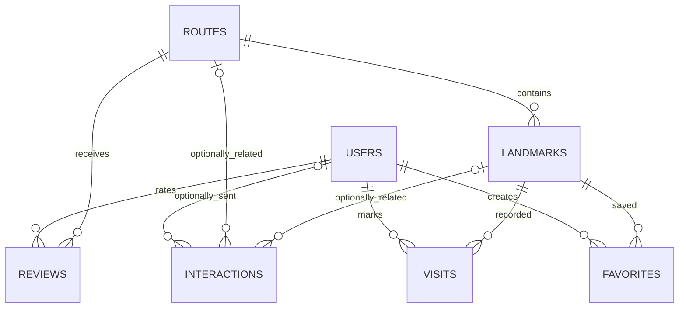

# Technical Documentation — Heritage Atlas

**Architecture version:** Phase 1 / October 2026

## 1. Architectural Overview

```text
Browser (mobile / desktop)
  ├─ React 19 + Next.js App Router UI (CSS + Framer Motion)
  ├─ Leaflet OpenStreetMap route maps (network tile service)
  ├─ Three.js procedural 3D / optional GLB loader (WebGL)
  ├─ getUserMedia camera → local AR camera overlay and jsQR decoding
  ├─ Web Speech API or admin audio URL
  └─ fetch('/api/...') with same-site session cookie
              │
              ▼
       Vercel Next.js server
  ├─ Public Server Components: routes / landmarks / stories
  ├─ REST route handlers: auth / favorites / visits / ratings / metrics / CMS
  ├─ zod request validation + request origin checks
  ├─ jose JWT verification (HttpOnly cookie, 7 days)
  └─ postgres client (pooled, max 1 per server instance)
              │
              ├──► Neon PostgreSQL (7 relational tables)
              └──► Vercel Blob (optional public media files)
```

Unlike an always-running Express server, server logic lives in Next.js API route handlers. This reduces deployment complexity on Vercel. HTML and public route data are rendered dynamically to reflect admin CMS edits; interactive browser-only libraries are lazy-loaded by the client.

## 2. Source Directory Guide

| Folder/file | Responsibility |
|---|---|
| `app/` | App Router page components, metadata, root layout, `globals.css` |
| `app/api/auth/*` | Sign-up, sign-in, sign-out, current session |
| `app/api/favorites`, `visits`, `reviews` | User persistence |
| `app/api/track` | Session/page/AR/audio/QR event ingestion |
| `app/api/admin/*` | Admin CMS, analytics and Blob uploads |
| `lib/db.ts` | DB connection and queries; bundled seed fallback when unconfigured |
| `lib/seed.ts` | Independently summarized site history and route metadata |
| `lib/auth.ts` | JWT sign/verify and role guards |
| `lib/validation.ts` | Zod schemas + same-origin mutation validation |
| `components/RouteMap.tsx` | Leaflet map, site pins, route ordering, geolocation UI |
| `components/ARExperience.tsx` | Camera stream + conceptual overlay + location check |
| `components/Scanner.tsx`, `QRBadge.tsx` | Local video QR decode and QR generation |
| `components/Monument3D.tsx` | Three.js procedural forms / GLB loader / controls |
| `components/StoryPlayer.tsx` | Spoken English/Hindi narratives |
| `components/AdminStudio.tsx` | Editable route and landmark management UI |
| `components/AnalyticsPanel.tsx` | Stored KPI aggregates |
| `scripts/migrate.mjs` | `CREATE TABLE IF NOT EXISTS` migrations and indexes |
| `scripts/seed.ts` | Idempotent seed insert for six landmarks |
| `scripts/create-admin.mjs` | First privileged account; does not promote existing users |
| `public/sw.js` | Limited caching for public navigations/assets |
| `public/images/` | Project-owned vector illustrations |

## 3. PostgreSQL Data Model



- `users`: text UUID primary key, normalized unique email, name, bcrypt password hash, `USER` / `ADMIN`, preferred_language and created_at.
- `routes`: text UUID, unique slug, name, city, tagline, description, image, coordinates, theme and featured.
- `landmarks`: text UUID, foreign-key route_id, unique slug, bilingual summaries and stories, JSONB timeline, optional model/audio/video URLs, source URL, GPS, featured and sort_order.
- `favorites`: `(user_id, landmark_id)` composite primary key and timestamp.
- `visits`: `(user_id, landmark_id)` composite primary key and timestamp.
- `interactions`: UUID, generated session ID, optional user/route/landmark FK, enum-like checked event type, duration_seconds, timestamp. Indexed on timestamp and associated landmark.
- `reviews`: route/user composite uniqueness, star integer 1–5.

**Migration command:** `npm run db:migrate` reads `.env.local` via Node 22's `--env-file` argument. `db:seed` inserts demo rows with `ON CONFLICT (id) DO NOTHING` so prior edits are preserved. No migrations run inside the production build.

### Content schema (landmark example)

```json
{
  "slug": "taj-mahal",
  "name": "Taj Mahal",
  "routeId": "route-agra",
  "latitude": 27.1751,
  "longitude": 78.0421,
  "era": "1631–1648",
  "summaryEn": "...",
  "summaryHi": "...",
  "storyEn": "...",
  "storyHi": "...",
  "timeline": [{"year":"1632","en":"Construction starts","hi":"निर्माण शुरू"}],
  "image": "/images/taj.svg",
  "modelUrl": "",
  "audioUrl": "",
  "sourceUrl": "https://whc.unesco.org/en/list/252/",
  "featured": true,
  "sortOrder": 1
}
```

Server accepts Zod-validated DTOs; do not use the JSON example directly for POST unless all required fields are supplied.

## 4. REST Endpoint Contract

| Method | URL | Auth | Request / purpose |
|---|---|---|---|
| GET | `/api/health` | Public | Returns `preview`, `ok` or `degraded` connection state |
| POST | `/api/auth/signup` | Public | `{ name, email, password }` → cookie, user |
| POST | `/api/auth/login` | Public | `{ email, password }` → cookie, user |
| POST | `/api/auth/logout` | Session optional | Clear signed cookie |
| GET | `/api/auth/me` | Public | `{user}` or `{user:null}` |
| GET | `/api/favorites` | USER | `{ids:[landmarkId...]}` |
| POST/DELETE | `/api/favorites` | USER | `{landmarkId}` toggle |
| GET/POST | `/api/visits` | USER | `{landmarkId}` save, or IDs list |
| POST | `/api/reviews` | USER | `{routeId,rating}` upsert 1–5 |
| POST | `/api/track` | Public, optional session | `{sessionId,eventType,routeId?,landmarkId?,durationSeconds?}` |
| GET | `/api/admin/routes` | ADMIN | Full DB route/landmark content |
| POST/PATCH/DELETE | `/api/admin/routes` | ADMIN | Route DTO or `{id}` delete |
| GET | `/api/admin/landmarks` | ADMIN | Full DB route/landmark content |
| POST/PATCH/DELETE | `/api/admin/landmarks` | ADMIN | Landmark DTO or `{id}` delete |
| GET | `/api/admin/analytics` | ADMIN | KPI aggregates, per-event/route/landmark breakdown, ratings |
| POST | `/api/admin/upload` | ADMIN | Multipart FormData key `file`; max 4 MB; returns `{url}` |

Failures return `{error: string}` with appropriate 400, 401, 403, 409, 500 or 503 where applicable. Some database runtime exceptions may surface as errors; production logs should be monitored. For telemetry, when `DATABASE_URL` is absent the track endpoint explicitly reports `{ok:true,stored:false}` instead of claiming to have stored an event.

## 5. Authentication and Security

- Passwords are salted/hardened with bcrypt, cost factor 12.
- `jose` signs JWTs as `HS256`, expires after seven days.
- Browser cookie name `heritage_session`; `HttpOnly`, `SameSite=Lax`, `Secure` in production.
- The server verifies the session signature and role for every admin page and mutation API.
- Login/signup mutations use `isSameOrigin` checks (when Origin header is provided); Zod validates payload sizes, URLs, slugs and fields.
- HTML is rendered by React, not populated with unescaped narrative HTML. Leaflet popup names escape `<` and slugs are validated.
- Upload MIME type, extension and file-size are checked. The file is stored publicly and the returned URL is used by the CMS.
- `DATABASE_URL`, `JWT_SECRET`, `ADMIN_PASSWORD` and Blob write token belong only in server-side environment variables.
- **Not implemented:** shared durable login brute-force throttling, bot prevention, custom authorization policies, audit logging, CSRF tokens as a second defense, comprehensive upload magic-byte scanning, malware scanning and production privacy consent. Require these for a large-scale public launch.

## 6. Functional Algorithms and Limits

### Route mapping

1. The route page server loads landmarks in persisted sort order.
2. Leaflet loads only in browser; it renders OSM standard tiles, attributed to OSM.
3. Draws numbered pins and a **dashed straight sequence line** between listed landmarks.
4. Popup links open a story and a geolocation button can estimate visitor distance.
5. Does not calculate turn-by-turn road directions, transport time, venue hours or permit status.

### Camera AR concept

1. User taps **Enable camera**; browser asks for permission; stream is attached to a persistent `<video>` DOM node.
2. Transparent Three.js scene displays rotating conceptual 3D architecture over the camera video layer.
3. **Not** fiducial-marker tracking, surface anchoring, visual-inertial odometry or occlusion-aware AR.
4. User explicitly checks GPS; Haversine formula estimates radius from coordinates; nearby match requires `distance <= 250m` and `accuracy <= 250m`.
5. If user is logged in, **Mark visited** inserts a visit row; note GPS does not securely authenticate presence.
6. Stream tracks are stopped on user request/unmount.

### QR scanner

1. Generates a public landmark story URL with `?unlock=qr` using `qrcode.react`.
2. `getUserMedia` uses a local device stream and `jsqr` decodes captured canvas pixels every ~330ms; no raw camera video is uploaded.
3. Accepts `heritage://<slug>`, landmark path links and manual slugs; navigates to in-app story.
4. `qr_scan` is a telemetry event, not a security attestation.

### Audio

When a media file URL exists, use HTMLAudioElement; use `speechSynthesis` with `en-IN` or `hi-IN`. Voice availability and quality vary by browser / device. Users can read all stories without audio.

### Conceptual 3D

Three.js constructs monument-inspired forms from boxes, cylinders and spheres with accessible drag rotation and automatic slow rotation. If `modelUrl` is set, try to load GLB via GLTFLoader and normalize the model; fall back if unavailable. Historic proportions are not certified.

### Analytics

A browser session stores an ephemeral ID in sessionStorage and sends page_view, audio_play, ar_open, qr_scan and component unmount session_end events. KPIs use SQL `COUNT`, `COUNT(DISTINCT)` and `AVG`. These are engagement estimates and not confirmed tourist counts.

### Service worker / offline

Caches a small public shell and successfully fetched public navigation/image requests. Dynamic import JS, map tiles and camera access remain device/network dependent. Do not promise entire application works offline.

## 7. Accessibility, Motion and Responsive UI

- Breakpoints around `1100px`, `860px`, `640px`, `390px`.
- Sticky header with mobile menu; responsive route cards, maps, CMS and content sidebar.
- Hero orbits/ambient floating elements, CSS scan animation and content reveal with Framer Motion.
- CSS disables animations and smooth scrolling for `prefers-reduced-motion: reduce`; additional UI accessibility testing recommended.
- Most controls are native buttons, links and labelled inputs. Landmark images use explanatory alt text.

## 8. Deployment Environment

| Variable | Required | Description |
|---|---|---|
| `DATABASE_URL` | Required for writable features | Neon pooled PostgreSQL URL with TLS |
| `JWT_SECRET` | Required for login | 32+ character random server-side secret |
| `ADMIN_EMAIL` | Admin create command only | Unique unused email |
| `ADMIN_PASSWORD` | Admin create command only | Unique 12+ character password |
| `BLOB_READ_WRITE_TOKEN` | Optional | Vercel Blob upload access |

Copy `.env.example` to `.env.local`. **Do not configure `ADMIN_PASSWORD` as a public client environment variable.** The admin CLI should normally run once from a secure local machine with Neon database access. It doesn't need to be installed as a Vercel runtime environment variable.

Review [DEPLOYMENT.md](DEPLOYMENT.md) for step-by-step production setup and testing.

## 9. Performance and Scaling

- Serverless connections are capped per pooled DB client; use Neon pooled URL rather than direct connection on large Vercel scale.
- Hero SVG is local. Next/Image is set to `unoptimized: true` for compatibility with arbitrary admin-provided remote HTTPS images; customize known image host patterns and a media processing pipeline for production performance.
- Three.js and Leaflet are loaded in client effects, not on server.
- No claimed measured Core Web Vitals: test actual deployments with Lighthouse and low-end smartphones.
- Cache policy and OSM tile service use must be reviewed for real visitor volume; hosted tiles with capacity/terms may be needed.

## 10. Quality Assurance and Known Gaps

See [TEST_REPORT.md](TEST_REPORT.md) for executed source-integrity checks and outstanding build/browser/live E2E testing. A real release requires verification of auth, cookies, DB constraints, remote asset loading, all APIs, web camera, map, Hindi voice, admin CRUD and analytics on deployed HTTPS.
